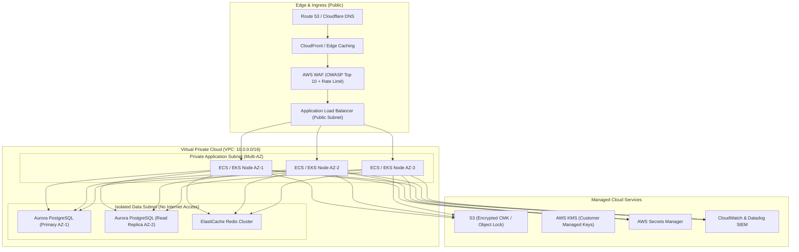

# Infrastructure Design Document (IDD) Template

> **Document Status:** Draft / Under Review / Approved  
> **Project Name:** [Project Name]  
> **Author:** [Lead Cloud Architect / DevOps Lead]  
> **Target Cloud:** AWS / GCP / Azure / Hybrid  
> **Version:** 1.0.0 &bull; **Date:** YYYY-MM-DD

---

## 1. Executive Summary & Infrastructure Goals

Provide a 2-paragraph overview of the infrastructure architecture, its target scalability requirements, and the core availability metrics (e.g. multi-AZ 99.99% uptime target).

| Metric | Target Specification |
| :--- | :--- |
| **Peak Throughput** | [e.g. 5,000 req/sec] |
| **Target P95 Latency** | [e.g. < 150 ms at Edge] |
| **Target Availability (SLA)** | [e.g. 99.95% / Multi-AZ Active-Active] |
| **RPO / RTO** | RPO: [e.g. < 5 mins] &bull; RTO: [e.g. < 30 mins] |
| **Estimated Monthly Cloud Cost** | [e.g. $2,450 / month at baseline] |

---

## 2. Cloud Architecture Topology (C4 Infrastructure Diagram)

---

## 3. Network Architecture & Subnet Planning

| Subnet Identifier | CIDR Block | Availability Zone | Routing / Internet Gateway | Purpose |
| :--- | :--- | :--- | :--- | :--- |
| `public-subnet-1a` | `10.0.1.0/24` | `us-east-1a` | Direct IGW Route | Ingress ALBs, NAT Gateway #1 |
| `public-subnet-1b` | `10.0.2.0/24` | `us-east-1b` | Direct IGW Route | Ingress ALBs, NAT Gateway #2 |
| `private-app-1a` | `10.0.10.0/22` | `us-east-1a` | Egress via NAT Gateway #1 | Container Workloads / Microservices |
| `private-app-1b` | `10.0.14.0/22` | `us-east-1b` | Egress via NAT Gateway #2 | Container Workloads / Microservices |
| `data-isolated-1a` | `10.0.20.0/24` | `us-east-1a` | No Internet / VPC Endpoints only | Aurora PostgreSQL Primary |
| `data-isolated-1b` | `10.0.21.0/24` | `us-east-1b` | No Internet / VPC Endpoints only | Aurora PostgreSQL Read Replica |

---

## 4. Compute, Container & Orchestration Sizing

- **Cluster Engine:** [Amazon EKS v1.30 / ECS Fargate]
- **Worker Node Groups:**
  - Standard Workload: `m6i.large` (2 vCPU, 8 GB RAM), autoscaling min: 3, max: 12.
  - Memory-Intensive Workload (Analytics/Cache): `r6i.xlarge` (4 vCPU, 32 GB RAM).
- **Horizontal Pod Autoscaling (HPA):**
  - CPU Threshold: 70% average utilization.
  - Memory Threshold: 80% average utilization.
  - Scale-up stabilization window: 0s &bull; Scale-down stabilization window: 300s.

---

## 5. Persistence, Backups & Disaster Recovery

- **Primary Database:** [Aurora PostgreSQL Serverless v2 / DynamoDB Global Tables]
- **Storage Encryption:** AWS KMS Customer Managed Key (`alias/prod-rds-key`).
- **Backup Strategy:**
  - Automated snapshots taken nightly at 02:00 UTC with 35-day retention.
  - Point-in-Time Recovery (PitR) enabled up to 5-minute granularity.
  - Weekly cross-region replication to `us-west-2` standby vault.
- **Failover SLA:** Automatic Multi-AZ failover within 35 seconds.

---

## 6. Security, Identity & Secret Injection

- **IAM Roles for Service Accounts (IRSA):** Containers assume scoped IAM roles via OpenID Connect (OIDC); no static AWS credentials embedded in containers.
- **Secrets Management:** Secrets stored in AWS Secrets Manager; synchronized to Kubernetes Secrets via External Secrets Operator (ESO) with automated 60-day rotation.
- **WAF Rule Sets:**
  1. AWSManagedRulesCommonRuleSet (OWASP Top 10 mitigation).
  2. AWSManagedRulesSQLiRuleSet (SQL injection defense).
  3. IP Rate Limiting: 2,000 requests per 5-minute sliding window per IP.

---

## 7. Sign-off & Peer Review

| Role | Reviewer Name | Signature | Date |
| :--- | :--- | :--- | :--- |
| **Lead Cloud Architect** | [Name] | [Signed] | YYYY-MM-DD |
| **Principal DevOps / SRE** | [Name] | [Signed] | YYYY-MM-DD |
| **Security Officer** | [Name] | [Signed] | YYYY-MM-DD |
| **Client Infrastructure Lead** | [Name] | [Signed] | YYYY-MM-DD |
