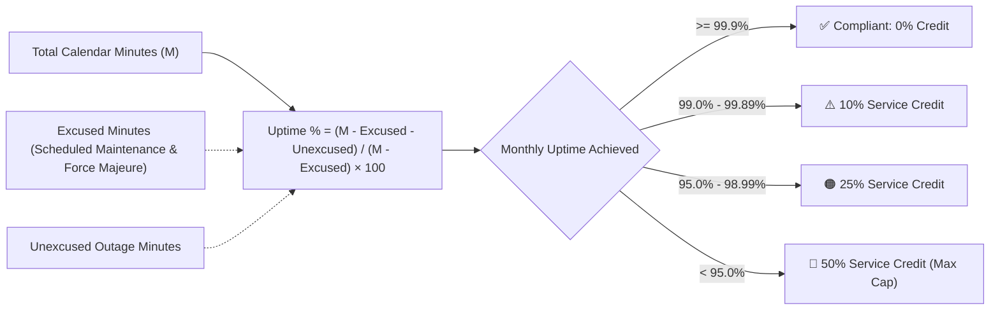

# Service Level Agreement (SLA) & Service Credit Specification

> **Commercial & Operational Contract Schedule**  
> **Customer / Organization:** [Client Enterprise Name] &bull; **Service Provider:** [Provider Legal Name]  
> **System / Service Covered:** [Platform Name / API Services] &bull; **Contract Reference:** SOW-YYYY-XXX  
> **Target Availability Commitment:** [ ] 99.9% (Three Nines &bull; 43.8m/mo downtime) &nbsp; [ ] 99.95% (21.9m/mo) &nbsp; [ ] 99.99% (Four Nines &bull; 4.38m/mo)  
> **Effective Date:** YYYY-MM-DD &bull; **Review Cadence:** Annual  

---

## 1. Service Availability Commitment

The Service Provider commits to providing monthly **System Availability** of no less than the agreed Service Tier target during each calendar month:

### 1.1 Availability Calculation Formula
Monthly Uptime Percentage is calculated on a calendar month basis as follows:

$$\text{Uptime Percentage} = \frac{\text{Total Scheduled Minutes} - \text{Excused Downtime} - \text{Unscheduled Downtime}}{\text{Total Scheduled Minutes} - \text{Excused Downtime}} \times 100$$

Where:
- **Total Scheduled Minutes:** 43,200 minutes (30-day month) or 44,640 minutes (31-day month).
- **Excused Downtime:** Minutes consumed by pre-notified scheduled maintenance windows or authorized emergency maintenance.
- **Unscheduled Downtime:** Consecutive minutes during which production API ingress returns HTTP 5xx errors or synthetic health probes report unresponsiveness.

---

## 2. Service Credit Schedule

If the Monthly Uptime Percentage falls below the committed target, Customer is entitled to claim **Service Credits** applied against future invoice billings:

| Monthly Uptime Percentage | Tier A (99.9% Target) Service Credit | Tier B (99.95% Target) Service Credit | Tier C (99.99% Target) Service Credit |
| :--- | :--- | :--- | :--- |
| **Committed Target Achieved** | **0%** (Full SLA compliance) | **0%** (Full SLA compliance) | **0%** (Full SLA compliance) |
| **99.50% to 99.89%** | 5% Monthly Fee Credit | 10% Monthly Fee Credit | 15% Monthly Fee Credit |
| **99.00% to 99.49%** | 10% Monthly Fee Credit | 15% Monthly Fee Credit | 25% Monthly Fee Credit |
| **95.00% to 98.99%** | 25% Monthly Fee Credit | 30% Monthly Fee Credit | 40% Monthly Fee Credit |
| **< 95.00% (Critical Breach)** | **50% Monthly Fee Credit** | **50% Monthly Fee Credit** | **50% Monthly Fee Credit** |

*Note: Total cumulative Service Credits in any single calendar month shall not exceed **50%** of the monthly recurring service fee for that month.*

---

## 3. Incident Severity Levels & Response / Resolution SLAs

The Service Provider will respond to and remediate reported incidents according to the following binding timetable:

| Severity Level | Operational Definition | Initial Response SLA | Status Update Cadence | Target Resolution / Workaround SLA |
| :--- | :--- | :--- | :--- | :--- |
| **Severity 1 (Critical Outage)** | Complete production outage; core transaction flow halted; no workaround available. | **< 15 Minutes** (24/7/365) | Every **30 Minutes** | **< 4 Hours** |
| **Severity 2 (Major Impairment)** | Significant functionality degraded; performance severely degraded; workaround available. | **< 1 Hour** (24/7/365) | Every **2 Hours** | **< 8 Hours** |
| **Severity 3 (Minor Defect)** | Non-critical component impaired; core business operations unaffected. | **< 4 Business Hours** | Daily | **< 5 Business Days** |
| **Severity 4 (Informational / Request)** | General inquiry, documentation question, or minor UI cosmetic issue. | **< 1 Business Day** | Weekly | Next Scheduled Release |

---

## 4. Maintenance Windows & Exclusions

### 4.1 Scheduled Maintenance
1. **Regular Maintenance Window:** Sundays between **02:00 UTC and 04:00 UTC** (maximum 2 hours per calendar month).
2. **Advance Notice Requirement:** Written notice must be provided via email or status page notification at least **5 business days** in advance.
3. **Emergency Maintenance:** Critical zero-day security patches or immediate infrastructure threats may be applied with at least **2 hours** advance notice.

### 4.2 SLA Exclusions
The following events are explicitly excluded from the calculation of Unscheduled Downtime:
- Outages caused by Customer’s own network, upstream ISP, or customer-managed integration code.
- Downtime resulting from Customer’s refusal to apply critical security patches or recommended architecture updates.
- Widespread outages of public hyperscaler cloud services (AWS / Azure / GCP) affecting entire geographical availability regions (Force Majeure).
- Client testing activities exceeding agreed capacity limits without prior coordination (e.g. uncoordinated load/stress tests).

---

## 5. Service Credit Claim & Dispute Protocol

1. **Claim Submission:** To receive a Service Credit, Customer must notify Service Provider in writing within **30 calendar days** of the end of the month in which the incident occurred.
2. **Evidence Requirements:** The claim must specify the date, time, ticket ID, and duration of the outage.
3. **Credit Application:** Approved Service Credits will be credited against the Customer’s next subsequent monthly invoice. Service Credits have no cash liquidation value.

---

## 6. Formal Sign-Off & Execution

This Service Level Agreement Schedule is incorporated into and made an integral part of the Master Services Agreement (MSA) between the parties.

| Organization | Authorized Representative | Title | Digital Signature | Execution Date |
| :--- | :--- | :--- | :--- | :--- |
| **Client Enterprise** | [Client Name] | VP of Technology / Sponsor | [Signed] | YYYY-MM-DD |
| **Service Provider** | [Provider Name] | Head of Global Delivery | [Signed] | YYYY-MM-DD |
| **Operations Lead** | [Ops Name] | Director of SRE & Operations | [Signed] | YYYY-MM-DD |

---

## 7. Related Framework Standards & Incident Runbooks

- [Incident Management & SLA Escalation Matrix](INCIDENT_MANAGEMENT_AND_SLA_MATRIX.md)
- [SLO & Error Budget Policy](../docs/ops/SLO_AND_ERROR_BUDGET_POLICY.md)
- [Business Impact Analysis (BIA)](BUSINESS_IMPACT_ANALYSIS_BIA.md)
- [Operations Runbook (Day-2 Playbook)](OPERATIONS_RUNBOOK.md)
- [Incident War Room Communications Playbook](../docs/ops/INCIDENT_WAR_ROOM_COMMUNICATIONS_PLAYBOOK.md)
