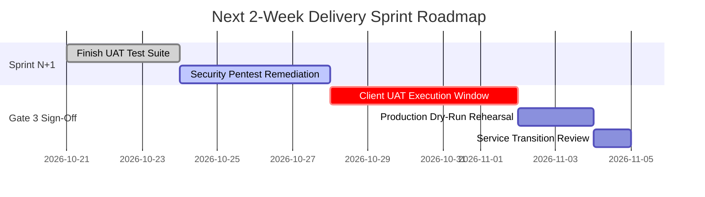

# Weekly Steering Committee
## Project: [Project / Client Name]

**Reporting Period:** [Week Number, e.g. Week 42 (Oct 14 - Oct 20, 2026)]  
**Delivery Lead:** [Lead Name] &bull; **Client Sponsor:** [Client Executive Name]  
**Overall Project Health:** <span class="badge-green">ON TRACK (GREEN)</span>

---

## Slide 1: Executive Status & Milestone Burn-Up

| Core Milestone | Target Gate | SOW Baseline Date | Forecast Date | Status |
| :--- | :--- | :--- | :--- | :--- |
| **M1: Discovery & Architecture Sign-off** | Gate 0 & 1 | YYYY-MM-DD | YYYY-MM-DD | <span class="badge-green">COMPLETED</span> |
| **M2: Core API & Data Ingestion Engine** | Gate 2 | YYYY-MM-DD | YYYY-MM-DD | <span class="badge-green">COMPLETED</span> |
| **M3: Admin Portal & Client UAT Kickoff** | Gate 3 | YYYY-MM-DD | YYYY-MM-DD | <span class="badge-green">IN PROGRESS</span> |
| **M4: Production Cutover & Handover** | Gate 4 | YYYY-MM-DD | YYYY-MM-DD | <span class="badge-yellow">PLANNED</span> |

**Key Highlights This Week:**
- Completed 100% of Sprint [N] commitments (48 story points delivered).
- Automated CI pipeline passing with 88.4% unit & integration test coverage.
- Staging environment provisioned and seeded with synthetic test data.

---

## Slide 2: Scope, Budget & Velocity Metrics

```
Sprint Velocity (Story Points):
Sprint 1: [36 pts] ██████████
Sprint 2: [42 pts] ████████████
Sprint 3: [48 pts] ██████████████ (Peak)
Sprint 4: [45 pts] █████████████ (Forecast)
```

**Financial Budget & Effort Consumption:**
- **Approved SOW Hours:** 800 Hours ($120,000 USD)
- **Burned to Date:** 410 Hours ($61,500 USD &bull; 51.2% burned)
- **Milestone Progress:** 55% completed (Tracking ahead of budget curve)
- **Open Change Requests:** 1 pending review ($4,800 / 32 hours)

---

## Slide 3: Key Decisions Required from Client Sponsor

The following decisions require executive approval to protect the project critical path:

1. **Third-Party Payment Gateway Credentials (Decision #DEC-04):**
   - *Issue:* Staging webhook verification requires client Stripe sandbox secret keys.
   - *Impact:* Blocks end-to-end checkout automation test suite.
   - *Required Action:* Client IT Security to issue credentials by **Wednesday 17:00 UTC**.

2. **Phase 2 Scope Prioritization (Decision #DEC-05):**
   - *Issue:* Client requested CSV Bulk Order Import capability.
   - *Recommendation:* Adopt 1-in, 1-out trade-off: swap out PDF Report Generator to protect Nov 1 launch date.

---

## Slide 4: Risk & Blocker Escalation Matrix

| Risk ID | Description | Impact | Probability | Mitigation Strategy | Owner |
| :--- | :--- | :--- | :--- | :--- | :--- |
| **RSK-01** | Client single sign-on (SSO) SAML endpoint metadata delayed. | High | Medium | Engineering configured mock Okta IdP in staging to continue frontend integration without delay. | Client IT Lead |
| **RSK-02** | External ERP API rate limit throttling during batch load test. | Medium | High | Implemented Redis caching layer and exponential backoff retry queue. | Tech Lead |

---

## Slide 5: Lookahead — Next 2 Weeks Roadmap



**Next Steering Committee:** [Date & Time] &bull; *Questions & Open Discussion*

